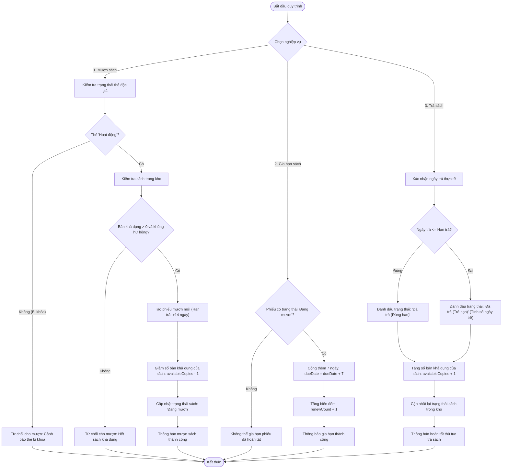

# BÁO CÁO BÀI TẬP LAB: HỆ THỐNG QUẢN LÝ THƯ VIỆN (LIBMASTER)

**Học phần:** Phát triển Ứng dụng Web / Công nghệ Phần mềm  
**Học kỳ:** HK1 (2026 - 2027)  
**Công cụ phát triển & Trợ lý AI:** Google AI Studio / Antigravity IDE (Gemini 3.8 Flash)  
**Công nghệ triển khai:** HTML5, CSS3, JavaScript (ES6+), LocalStorage  

---

## 1. TỔNG QUAN VÀ MỤC TIÊU DỰ ÁN

### 1.1. Bối cảnh
Công tác quản lý thư viện truyền thống thông qua sổ sách hoặc các bảng tính rời rạc thường dẫn đến sai sót trong việc theo dõi số lượng bản in tồn kho, thất lạc đầu sách, khó kiểm soát độc giả quá hạn và tốn nhiều thời gian đối soát khi trả sách.

### 1.2. Mục tiêu
Xây dựng một ứng dụng web Quản lý Thư viện đơn giản, trực quan, chạy trực tiếp trên trình duyệt web không phụ thuộc vào hạ tầng máy chủ phức tạp (Serverless client-side), đảm bảo thực thi đầy đủ và chính xác các quy tắc nghiệp vụ mượn/trả/gia hạn sách trong thư viện trường học hoặc cơ quan.

---

## 2. DANH SÁCH & MÔ TẢ CHI TIẾT CÁC CHỨC NĂNG

| STT | Nhóm chức năng | Tên chức năng chi tiết | Mô tả nghiệp vụ |
| :---: | :--- | :--- | :--- |
| **1** | **Dashboard** | Thống kê số lượng đầu sách | Đếm tổng số lượng tựa sách duy nhất đang quản lý trong cơ sở dữ liệu. |
| | | Thống kê số bản sao khả dụng | Tính tổng số bản in còn sẵn sàng trên giá sách cho bạn đọc mượn. |
| | | Thống kê phiếu đang mượn | Đếm tổng số giao dịch mượn chưa hoàn trả sách. |
| | | Thống kê phiếu quá hạn | Tự động phát hiện các phiếu mượn có hạn trả nhỏ hơn ngày hiện tại để đôn đốc thu hồi. |
| | | Cơ cấu thể loại sách | Hiển thị biểu đồ thanh tỷ lệ phân bổ các đầu sách theo từng thể loại. |
| **2** | **Quản lý Sách** | Thêm sách mới | Nhập mã, tên, tác giả, thể loại, tổng số bản in. Tự động tính số bản khả dụng. |
| | | Chỉnh sửa sách | Cập nhật thông tin chi tiết của sách; kiểm tra ràng buộc bản khả dụng $\le$ tổng số bản. |
| | | Xóa sách | Xóa sách khỏi kho; **ràng buộc an toàn:** chặn xóa nếu sách đang có người mượn. |
| | | Tìm kiếm & Bộ lọc | Tìm kiếm realtime theo mã, tên, tác giả; kết hợp lọc theo thể loại và trạng thái kho. |
| **3** | **Quản lý Độc giả** | Quản lý hồ sơ độc giả | Lưu trữ mã độc giả, họ tên, số điện thoại, email và ngày cấp thẻ. |
| | | Khóa / Mở khóa thẻ | Thao tác 1 chạm để chuyển đổi trạng thái thẻ giữa `Hoạt động` và `Bị khóa`. |
| | | Kiểm soát an toàn độc giả | Chặn xóa hồ sơ nếu độc giả đó đang giữ sách chưa hoàn trả. |
| | | Tìm kiếm & Lọc độc giả | Tra cứu nhanh bạn đọc theo tên, số điện thoại hoặc trạng thái thẻ. |
| **4** | **Nghiệp vụ Mượn/Trả** | Lập phiếu mượn mới | - Kiểm tra điều kiện độc giả: thẻ phải là `Hoạt động` (nếu `Bị khóa` $\rightarrow$ chặn).<br>- Kiểm tra kho: bản khả dụng $> 0$ và không `Hư hỏng`/`Thất lạc`.<br>- Tự động giảm $1$ bản khả dụng của sách.<br>- Tự động thiết lập hạn trả ($14$ ngày). |
| | | Gia hạn phiếu mượn | Cho phép độc giả gia hạn thêm $+7$ ngày vào hạn trả quy định; tăng số lần gia hạn. |
| | | Nhận trả sách | - Nhập ngày trả thực tế.<br>- Đối soát tự động: nếu $\le$ hạn trả $\rightarrow$ `Đúng hạn`; nếu $>$ hạn trả $\rightarrow$ `Trễ hạn` (kèm số ngày trễ).<br>- Tự động hoàn trả $+1$ bản sao vào kho và đồng bộ trạng thái sách. |
| **5** | **Hệ thống** | Khôi phục dữ liệu mẫu | Đưa toàn bộ cơ sở dữ liệu về bộ dữ liệu chuẩn ban đầu nhằm phục vụ nghiệm thu/demo. |
| | | Thông báo trạng thái (Toast) | Hiển thị thông báo phản hồi sinh động khi thao tác thành công hoặc vi phạm quy tắc. |

---

## 3. SƠ ĐỒ QUY TRÌNH NGHIỆP VỤ MƯỢN - GIA HẠN - TRẢ SÁCH

### 3.1. Sơ đồ quy trình tổng thể (Mermaid Flowchart)



### 3.2. Giải thích chi tiết các bước xử lý nghiệp vụ

1. **Nghiệp vụ Cho mượn Sách**:
   - **Bước 1**: Thủ thư chọn độc giả và tựa sách muốn mượn.
   - **Bước 2 (Kiểm tra độc giả)**: Hệ thống truy vấn trường `status` của đối tượng độc giả. Nếu giá trị là `"Bị khóa"` (do độc giả có vi phạm trước đó hoặc nợ phạt), quy trình lập tức bị hủy bỏ và gửi cảnh báo `Toast Danger` tới thủ thư.
   - **Bước 3 (Kiểm tra kho sách)**: Hệ thống kiểm tra trường `availableCopies`. Nếu số lượng $\le 0$ hoặc trạng thái sách là `"Hư hỏng"`, `"Thất lạc"`, hệ thống từ chối tạo phiếu mượn.
   - **Bước 4 (Khởi tạo giao dịch)**: Nếu hai điều kiện trên đều thỏa mãn, phiếu mượn mới được tạo với mã duy nhất `PMxxx`, ngày mượn là thời điểm hiện tại và hạn trả tự động tính bằng cách cộng thêm $14$ ngày.
   - **Bước 5 (Trừ kho)**: Sách tương ứng bị trừ $1$ bản sao khả dụng (`availableCopies = availableCopies - 1`). Trạng thái sách được chuyển thành `"Đang mượn"`.

2. **Nghiệp vụ Gia hạn Phiếu mượn**:
   - Khi độc giả có nhu cầu kéo dài thời gian mượn, thủ thư chọn chức năng **Gia hạn +7d**.
   - Hệ thống kiểm tra phiếu mượn: chỉ cho phép gia hạn các phiếu đang ở trạng thái `"Đang mượn"`.
   - Hạn trả mới được xác định: $\text{dueDate mới} = \text{dueDate cũ} + 7 \text{ ngày}$.
   - Biến `renewCount` tăng thêm $1$ nhằm ghi nhận lịch sử phục vụ việc kiểm toán sau này.

3. **Nghiệp vụ Trả Sách & Hoàn Kho**:
   - Thủ thư mở hộp thoại xác nhận trả sách cho phiếu mượn tương ứng.
   - Ngày trả thực tế (`returnDate`) mặc định là ngày hiện tại, hoặc thủ thư có thể chọn ngày chính xác theo biên bản.
   - **Thuật toán đối soát**:
     $$\Delta t = \text{returnDate} - \text{dueDate}$$
     - Nếu $\Delta t \le 0$: Hệ thống ghi nhận trạng thái phiếu là `"Đã trả (Đúng hạn)"`.
     - Nếu $\Delta t > 0$: Hệ thống tính số ngày trễ $\Delta t_{\text{ngày}} = \lceil \frac{\Delta t}{86400 \times 1000} \rceil$ và ghi nhận trạng thái `"Đã trả (Trễ hạn)"` kèm cảnh báo trực quan.
   - **Hoàn trả kho**: Số bản khả dụng của sách được hoàn lại: $\text{availableCopies} = \min(\text{totalCopies}, \text{availableCopies} + 1)$. Nếu toàn bộ sách đã về kho đầy đủ, trạng thái sách tự động chuyển thành `"Còn trong kho"`.

---

## 4. BẢNG MÔ TẢ CẤU TRÚC DỮ LIỆU (DATA DICTIONARY)

Dữ liệu được tổ chức dưới dạng các thực thể JSON và lưu trữ trong `HTML5 LocalStorage`.

### 4.1. Bảng Sách (`lib_books_data`)

| Tên trường | Kiểu dữ liệu | Khóa | Ràng buộc | Mô tả ý nghĩa |
| :--- | :--- | :---: | :--- | :--- |
| `id` | `String` | **PK** | Duy nhất, không rỗng, định dạng `BKxxx` | Mã định danh duy nhất của đầu sách |
| `title` | `String` | | Bắt buộc nhập, độ dài $1 - 255$ ký tự | Tên tựa sách |
| `author` | `String` | | Bắt buộc nhập | Họ tên tác giả hoặc đơn vị biên soạn |
| `category` | `String` | | Thuộc danh mục thể loại | Phân loại thể loại sách (CNTT, Kinh tế...) |
| `totalCopies` | `Number` | | Nguyên dương ($\ge 1$) | Tổng số bản in vật lý mà thư viện sở hữu |
| `availableCopies`| `Number` | | $0 \le \text{availableCopies} \le \text{totalCopies}$ | Số lượng bản in còn rảnh trong kho để mượn |
| `status` | `String` | | `Còn trong kho` \| `Đang mượn` \| `Hư hỏng` \| `Thất lạc` | Tình trạng hiện tại của tựa sách |

### 4.2. Bảng Độc Giả (`lib_readers_data`)

| Tên trường | Kiểu dữ liệu | Khóa | Ràng buộc | Mô tả ý nghĩa |
| :--- | :--- | :---: | :--- | :--- |
| `id` | `String` | **PK** | Duy nhất, không rỗng, định dạng `DGxxx` | Mã định danh thẻ độc giả |
| `fullName` | `String` | | Bắt buộc nhập | Họ và tên đầy đủ của độc giả |
| `phone` | `String` | | Bắt buộc nhập, $9 - 11$ chữ số | Số điện thoại liên hệ chính thức |
| `email` | `String` | | Hợp lệ theo định dạng email nếu có | Địa chỉ thư điện tử nhận thông báo |
| `status` | `String` | | `Hoạt động` \| `Bị khóa` | Trạng thái quyền mượn sách của thẻ thư viện |
| `createdAt` | `String` | | Định dạng `YYYY-MM-DD` | Ngày làm thẻ thư viện |

### 4.3. Bảng Phiếu Mượn (`lib_loans_data`)

| Tên trường | Kiểu dữ liệu | Khóa | Ràng buộc | Mô tả ý nghĩa |
| :--- | :--- | :---: | :--- | :--- |
| `id` | `String` | **PK** | Duy nhất, định dạng `PMxxx` | Mã số phiếu mượn |
| `readerId` | `String` | **FK** | Tham chiếu đến `Readers.id` | Mã độc giả mượn sách |
| `readerName` | `String` | | Tự động đồng bộ từ hồ sơ độc giả | Tên độc giả tại thời điểm lập phiếu |
| `bookId` | `String` | **FK** | Tham chiếu đến `Books.id` | Mã sách được mượn |
| `bookTitle` | `String` | | Tự động đồng bộ từ kho sách | Tên tựa sách tại thời điểm lập phiếu |
| `borrowDate` | `String` | | `YYYY-MM-DD`, không rỗng | Ngày bắt đầu cho mượn sách |
| `dueDate` | `String` | | `YYYY-MM-DD`, $\ge \text{borrowDate}$ | Ngày giới hạn phải trả sách về thư viện |
| `returnDate` | `String \| null`| | `YYYY-MM-DD` hoặc null khi chưa trả | Ngày độc giả thực tế đem trả sách |
| `status` | `String` | | `Đang mượn` \| `Đã trả (Đúng hạn)` \| `Đã trả (Trễ hạn)` | Trạng thái đối soát của giao dịch mượn/trả |
| `renewCount` | `Number` | | $\ge 0$, mặc định $0$ | Số lần phiếu đã được gia hạn thêm ngày |

---

## 5. BẢNG TEST CASE KIỂM THỬ HỆ THỐNG

| ID | Nhóm kiểm thử | Mục đích / Tên ca kiểm thử | Các bước thực hiện (Test Steps) | Dữ liệu đầu vào (Test Data) | Kết quả mong đợi (Expected Result) | Trạng thái |
| :---: | :--- | :--- | :--- | :--- | :--- | :---: |
| **TC01** | Khởi tạo hệ thống | Khởi động ứng dụng lần đầu và nạp dữ liệu mẫu | Mở `src/index.html` trên trình duyệt chưa có LocalStorage | Không nhập | Dashboard hiển thị đúng $7$ đầu sách, tổng bản sao khả dụng, số phiếu đang mượn và $1$ phiếu quá hạn | **PASS** |
| **TC02** | Quản lý Sách | Thêm sách mới hợp lệ | 1. Nhấn nút "Thêm Sách Mới"<br>2. Nhập các trường thông tin<br>3. Nhấn "Lưu thông tin" | Mã: `BK008`, Tên: `Kỹ Nghệ Phần Mềm`, Tác giả: `Roger S. Pressman`, Tổng bản: $5$, Khả dụng: $5$ | Thêm thành công, hiển thị Toast xanh, danh sách sách có thêm cuốn mới và Dashboard cập nhật số lượng | **PASS** |
| **TC03** | Ràng buộc Sách | Chặn xóa sách đang có người mượn | 1. Vào tab Quản lý Sách<br>2. Chọn sách `BK001` (đang có phiếu `PM001` mượn)<br>3. Nhấn "Xóa" | Sách `BK001` | Hệ thống ngăn chặn xóa, hiện Toast cảnh báo màu đỏ: "Không thể xóa cuốn sách này vì đang có độc giả mượn chưa trả!" | **PASS** |
| **TC04** | Quản lý Độc giả | Khóa thẻ độc giả đang hoạt động | 1. Vào tab Quản lý Độc giả<br>2. Tìm độc giả `DG001`<br>3. Nhấn nút "Khóa thẻ" | Độc giả `DG001` | Trạng thái thẻ chuyển thành `Bị khóa` (badge đỏ), Toast thông báo thẻ đã bị khóa | **PASS** |
| **TC05** | **Nghiệp vụ Mượn** | **Chặn mượn sách khi thẻ độc giả bị khóa** | 1. Nhấn "Tạo Phiếu Mượn Mới"<br>2. Chọn độc giả `DG004` (thẻ Bị khóa)<br>3. Chọn sách bất kỳ còn bản<br>4. Nhấn "Xác nhận cho mượn" | Độc giả `DG004` (Bị khóa), Sách `BK003` | Hệ thống từ chối tạo phiếu, phát Toast đỏ: "Độc giả có thẻ trạng thái [BỊ KHÓA]. Không thể mượn sách!" | **PASS** |
| **TC06** | **Nghiệp vụ Mượn** | **Chặn mượn sách khi hết bản khả dụng ($0$) hoặc hư hỏng** | 1. Nhấn "Tạo Phiếu Mượn Mới"<br>2. Chọn độc giả `DG003` (Hoạt động)<br>3. Chọn sách `BK006` (Khả dụng: $0/2$)<br>4. Nhấn "Xác nhận cho mượn" | Độc giả `DG003`, Sách `BK006` (Available = 0) | Hệ thống từ chối tạo phiếu, phát Toast đỏ: "Sách đã hết bản khả dụng hoặc đang ở trạng thái [Đang mượn]!" | **PASS** |
| **TC07** | **Nghiệp vụ Mượn** | **Tạo phiếu mượn thành công & tự trừ bản sao** | 1. Nhấn "Tạo Phiếu Mượn Mới"<br>2. Chọn độc giả `DG003`<br>3. Chọn sách `BK003` (đang có $3$ bản khả dụng)<br>4. Nhấn "Xác nhận cho mượn" | Độc giả `DG003`, Sách `BK003` | Phiếu mượn được tạo thành công; số bản khả dụng của sách `BK003` giảm từ $3 \rightarrow 2$; Dashboard tăng số phiếu mượn | **PASS** |
| **TC08** | **Nghiệp vụ Gia hạn**| **Gia hạn phiếu mượn thêm $+7$ ngày** | 1. Vào tab Mượn - Trả<br>2. Tìm phiếu `PM001` đang mượn (Hạn: $D$)<br>3. Nhấn nút "Gia hạn +7d" | Phiếu `PM001` | Hạn trả tăng lên thành $D + 7$; cột gia hạn hiển thị `+7d (1l)`; hiển thị Toast thông báo thành công | **PASS** |
| **TC09** | **Nghiệp vụ Trả** | **Trả sách đúng hạn & tự động hoàn kho bản sao** | 1. Chọn phiếu `PM001`<br>2. Nhấn "Trả sách"<br>3. Chọn ngày trả $\le$ hạn trả<br>4. Nhấn "Hoàn tất nhận trả sách" | Phiếu `PM001`, Ngày trả $\le$ Hạn trả | Phiếu chuyển trạng thái `Đã trả (Đúng hạn)`; sách `BK001` được tăng lại $+1$ bản khả dụng; số phiếu đang mượn giảm $1$ | **PASS** |
| **TC10** | **Nghiệp vụ Trả** | **Trả sách trễ hạn (phát hiện quá hạn)** | 1. Chọn phiếu `PM002` (Hạn trả trong quá khứ)<br>2. Nhấn "Trả sách"<br>3. Chọn ngày trả là hôm nay ($>$ Hạn trả)<br>4. Xác nhận trả sách | Phiếu `PM002`, Ngày trả $>$ Hạn trả | Giao diện cảnh báo trễ hạn $x$ ngày; sau khi xác nhận, phiếu đổi thành `Đã trả (Trễ hạn)` (badge cam); sách `BK006` tăng khả dụng lên $1$ | **PASS** |
| **TC11** | Chức năng Hệ thống | Khôi phục dữ liệu mẫu ban đầu | 1. Nhấn nút "Khôi phục dữ liệu mẫu" trên Header<br>2. Xác nhận hộp thoại Confirm | Thao tác xác nhận | Dữ liệu lập tức quay về trạng thái mẫu ban đầu; toàn bộ các bảng và thống kê được render lại đồng bộ | **PASS** |

---

## 6. MINH CHỨNG QUÁ TRÌNH THỰC HIỆN TRÊN GOOGLE AI STUDIO / ANTIGRAVITY IDE

> [!NOTE]
> Mục này chừa sẵn các vị trí khung ảnh và chú thích chi tiết để học viên/nhóm sinh viên chèn ảnh chụp màn hình minh chứng quá trình prompt, thiết kế và kiểm thử ứng dụng cùng Trợ lý AI.

### 6.1. Ảnh chụp màn hình tương tác lệnh (Prompting) trên AI Studio / Antigravity IDE
*Mô tả: Minh chứng câu lệnh mô tả bài toán, thiết kế kiến trúc hệ thống và nhận gợi ý mã nguồn từ Gemini.*

```
+---------------------------------------------------------------------------------------+
|                                                                                       |
|                                                                                       |
|                   [ CHÈN ẢNH CHỤP MÀN HÌNH GIAO DIỆN TƯƠNG TÁC PROMPT ]               |
|                      (Google AI Studio / Antigravity Chat Panel)                      |
|                                                                                       |
|                                                                                       |
+---------------------------------------------------------------------------------------+
```
*(Hình 6.1: Quá trình thiết kế cấu trúc dữ liệu và logic nghiệp vụ mượn trả cùng Trợ lý AI)*

---

### 6.2. Ảnh chụp màn hình Dashboard và thống kê thời gian thực
*Mô tả: Minh chứng giao diện Dashboard hiển thị đầy đủ 4 thẻ chỉ số và cơ cấu thể loại sách.*

```
+---------------------------------------------------------------------------------------+
|                                                                                       |
|                                                                                       |
|                   [ CHÈN ẢNH CHỤP MÀN HÌNH DASHBOARD TỔNG QUAN ]                      |
|                      (Stat Cards, Phiếu mượn cần lưu ý & Biểu đồ)                     |
|                                                                                       |
|                                                                                       |
+---------------------------------------------------------------------------------------+
```
*(Hình 6.2: Màn hình Dashboard quản lý số liệu vận hành thư viện)*

---

### 6.3. Ảnh chụp màn hình kiểm thử kiểm soát quy tắc nghiệp vụ (Validation)
*Mô tả: Minh chứng hệ thống phát hiện và chặn độc giả có thẻ "Bị khóa" hoặc sách đã hết bản khả dụng.*

```
+---------------------------------------------------------------------------------------+
|                                                                                       |
|                                                                                       |
|             [ CHÈN ẢNH CHỤP THÔNG BÁO TỪ CHỐI MƯỢN SÁCH KHI THẺ BỊ KHÓA ]             |
|                       (Toast notification màu đỏ và gợi ý lỗi)                        |
|                                                                                       |
|                                                                                       |
+---------------------------------------------------------------------------------------+
```
*(Hình 6.3: Thông báo Toast màu đỏ từ chối cho mượn đối với độc giả bị khóa thẻ)*

---

### 6.4. Ảnh chụp màn hình đối soát trả sách Đúng hạn / Trễ hạn
*Mô tả: Minh chứng modal đối soát ngày trả thực tế và tự động tính toán số ngày trễ hạn.*

```
+---------------------------------------------------------------------------------------+
|                                                                                       |
|                                                                                       |
|             [ CHÈN ẢNH CHỤP MODAL TRẢ SÁCH TỰ ĐỘNG ĐỐI SOÁT HẠN TRẢ ]                 |
|                      (Hiển thị badge Đúng hạn / Trễ hạn trực quan)                    |
|                                                                                       |
|                                                                                       |
+---------------------------------------------------------------------------------------+
```
*(Hình 6.4: Hộp thoại xác nhận trả sách và tự động đánh giá tình trạng trễ hạn)*

---

## 7. KẾT LUẬN & ĐÁNH GIÁ

- **Ưu điểm của giải pháp**:
  - Không cần cài đặt bất kỳ dependency nặng nề nào; chạy trực tiếp và tức thì trên mọi trình duyệt hiện đại.
  - Xử lý mượt mà toàn bộ quy trình vòng đời của sách: Nhập kho $\rightarrow$ Cho mượn $\rightarrow$ Gia hạn $\rightarrow$ Trả sách $\rightarrow$ Hoàn kho.
  - Cơ chế bẫy lỗi và thông báo trạng thái Toast notification chuyên nghiệp, thân thiện với người dùng.
  - Lưu trữ dữ liệu liên tục (persistent) thông qua `LocalStorage` và cung cấp nút "Khôi phục dữ liệu mẫu" tiện lợi.
- **Hướng phát triển mở rộng**:
  - Tích hợp thêm tính năng quét mã vạch / QR Code của thẻ độc giả và mã sách bằng camera qua API `navigator.mediaDevices`.
  - Hỗ trợ xuất dữ liệu danh sách báo cáo ra định dạng file Excel (.xlsx) hoặc PDF.
